<p align="center">
  
</p>

<p align="center">
  <a href="https://www.anypayx.com"></a>
  <a href="https://crates.io/crates/anypay"></a>
  <a href="https://github.com/anypay/anypay-rust"></a>
  <a href="LICENSE"></a>
</p>

<p align="center">
  <a href="https://www.anypayx.com">Website</a> ·
  <a href="https://www.anypayx.com/docs">Docs</a> ·
  <a href="https://api.anypayx.com/api">API</a> ·
  <a href="https://www.anypayx.com/walletbot">WalletBot</a> ·
  <a href="https://github.com/anypay">GitHub</a> ·
  <a href="https://crates.io/crates/anypay">crates.io</a>
</p>

---

## What It Is & Purpose

**Anypay Rust** is a high-performance, production-grade payment processing engine published as the `anypay` crate on crates.io. It provides three powerful tools: a **WebSocket server** for real-time payment notifications, a **CLI** for creating and managing invoices across multiple blockchains, and a **self-custody wallet** for signing and broadcasting transactions.

Built in Rust for maximum reliability and performance, it handles Bitcoin, Ethereum, XRP, Solana, Bitcoin SV, Fractal Bitcoin, and stablecoins like RLUSD through a clean plugin architecture. Each supported chain is a self-contained plugin implementing address validation, transaction signing, broadcasting, and confirmation tracking.

The platform integrates with Anypay's invoice API and provides WebSocket streams for real-time payment updates, making it the foundational payment engine for merchants, developers, and applications that need trustless cryptocurrency payment processing.

## Why Use It

**Anypay Rust** brings enterprise-grade cryptocurrency payment infrastructure to any application or terminal. Whether you're accepting payments at a point-of-sale, automating invoice settlement, or building a headless payment gateway, this crate delivers the primitives you need.

- **Who it's for:** Rust developers building payment systems, merchants needing CLI-based invoice management, and applications requiring real-time WebSocket payment streams or self-custody wallet automation.
- **Where it fits:** This is the **core Rust payment engine** in the Anypay stack. It sits below the Node.js platform (`@anypay/server`) and provides native-speed payment primitives, plugin-based chain support, and direct blockchain interaction without JavaScript overhead. Use it standalone for Rust applications or as a sidecar service feeding payment data to any stack via WebSocket.

## How It Works

<p align="center">
  
</p>

Anypay Rust implements a **plugin-based payment architecture** with four stages:

1. **Invoice Request** — The CLI or WebSocket client requests a new payment invoice, specifying amount, currency, and optional webhook/redirect URLs.
2. **Plugin Router** — The core engine selects the appropriate blockchain plugin (Bitcoin, Ethereum, XRP, Solana, BSV, Fractal Bitcoin, or RLUSD) based on the requested chain and currency.
3. **Chain Broadcast** — The selected plugin validates addresses, constructs transactions, signs them (wallet mode), and broadcasts to the target blockchain node or API.
4. **Confirmed** — The engine tracks confirmations via blockchain listeners (Blockbook, native chain WebSockets, or polling APIs) and publishes real-time payment status updates through the WebSocket server.

Plugins are async Rust traits (`src/plugin/mod.rs`) implementing `build_signed_payment`, `verify_payment`, `broadcast_tx`, `get_confirmation`, and `get_price`. Adding a new chain means implementing one clean interface — no changes to the CLI, server, or wallet binaries.

The WebSocket server (`anypay-server`) maintains persistent connections with clients, dispatches invoice events through RabbitMQ, and streams price updates from Supabase. The wallet (`anypay-wallet`) generates BIP39 seed phrases, derives hierarchical deterministic keys, and signs transactions locally without exposing private keys to external services.

## Quickstart / How to Use It

### Installation

Install from crates.io (publishes all three binaries):

```bash
cargo install anypay
```

This installs `anypay-cli`, `anypay-server`, and `anypay-wallet` to your Cargo bin directory.

Or build from source:

```bash
git clone https://github.com/anypay/anypay-rust.git
cd anypay-rust
cargo build --release
# Binaries in target/release/
```

### CLI Usage

Set your Anypay API token:

```bash
export ANYPAY_TOKEN=your_api_token_here
```

Create an invoice:

```bash
anypay-cli create-invoice \
  --amount 100 \
  --currency USD \
  --webhook https://example.com/webhook \
  --redirect https://example.com/success \
  --memo "Payment for services"
```

Request a payment with specific parameters:

```bash
anypay-cli request-payment \
  --currency BTC \
  --address bc1qxy2kgdygjrsqtzq2n0yrf2493p83kkfjhx0wlh \
  --amount 100 \
  --quote-currency USD
```

Submit a signed payment transaction:

```bash
anypay-cli submit-payment \
  --uid inv_abc123 \
  --chain BTC \
  --currency BTC \
  --txhex 0200000001...
```

Monitor invoice updates in real-time:

```bash
anypay-cli monitor inv_abc123
```

Get current cryptocurrency prices:

```bash
anypay-cli get-prices
```

Additional CLI flags: `--json` (JSON output), `--api-url` (custom endpoint), `--ws-url` (custom WebSocket).

### Server Usage

Configure via environment variables:

```bash
export SUPABASE_URL=your_supabase_url
export SUPABASE_ANON_KEY=your_anon_key
export SUPABASE_SERVICE_ROLE_KEY=your_service_role_key
export PORT=8080
export HTTP_PORT=3000
export AMQP_URL=amqp://localhost:5672  # Optional
export XRPL_WSS_URL=wss://xrplcluster.com  # Optional
export ETH_WSS_URL=wss://eth-mainnet.g.alchemy.com/v2/...  # Optional
```

Run the server:

```bash
anypay-server
```

The WebSocket server listens on `ws://0.0.0.0:8080` by default. The HTTP API server listens on `http://0.0.0.0:3000`. Enable debug logs with `--debug`.

### Wallet Usage

Generate a new BIP39 wallet:

```bash
anypay-wallet generate
```

Create a payment card (address) for a specific chain:

```bash
export ANYPAY_WALLET_SEED_PHRASE="your twelve word seed phrase here"

anypay-wallet create-card \
  --chain BTC \
  --currency BTC \
  --network mainnet \
  --account 0
```

Check balances:

```bash
anypay-wallet balance --chain BTC --currency BTC
```

Pay an Anypay invoice directly from your wallet:

```bash
anypay-wallet pay inv_abc123 \
  --chain BTC \
  --currency BTC \
  --network mainnet \
  --account 0
```

The wallet never uploads your seed phrase or private keys — all signing happens locally.

### Supported Chains & Plugins

| Chain | Currency | Plugin | Features |
|-------|----------|--------|----------|
| **BTC** | BTC | `BitcoinPlugin` | P2WPKH, SegWit, Blockbook |
| **ETH** | ETH | `EthereumPlugin` | Native ETH, ERC-20 |
| **ETH** | RLUSD | `RLUSDEthereumPlugin` | Ripple stablecoin on Ethereum |
| **XRP** | XRP | `RipplePlugin` | XRP Ledger, native WebSocket |
| **SOL** | SOL | `SolanaPlugin` | Solana native transfers |
| **BSV** | BSV | `BitcoinSVPlugin` | Bitcoin SV (Satoshi Vision) |
| **FB** | FB | `FractalBitcoinPlugin` | Fractal Bitcoin |

Each plugin implements the `Plugin` trait (`src/plugin/mod.rs`) with methods for address validation, transaction building, signing, broadcasting, confirmation tracking, and price feeds.

### Library Usage

Add to your `Cargo.toml`:

```toml
[dependencies]
anypay = "0.1"
```

Use the plugin system in your Rust application:

```rust
use anypay::plugin::{get_plugin, PaymentOption};

#[tokio::main]
async fn main() -> anyhow::Result<()> {
    let plugin = get_plugin("BTC", "BTC").expect("Bitcoin plugin");
    
    let payment_option = PaymentOption {
        chain: "BTC".to_string(),
        currency: "BTC".to_string(),
        address: "bc1q...".to_string(),
        amount: 50000, // satoshis
        uri: None,
    };
    
    let is_valid = plugin.validate_address(&payment_option.address).await?;
    println!("Address valid: {}", is_valid);
    
    Ok(())
}
```

Access invoice, session, prices, WebSocket client, and wallet modules from `use anypay::*`.

## Next Moves for Growth

High-leverage improvements grounded in the current state of `anypay-rust`:

1. **Publish v0.1.0 to crates.io** — The `Cargo.toml` is configured but the crate does not appear published yet. Run `cargo publish` after ensuring `LICENSE` is present and all plugin implementations are production-ready. This makes `cargo install anypay` work for end users.

2. **Add integration tests for each plugin** — The repository contains no `tests/` directory. Create integration tests that validate address generation, transaction signing, and broadcasting against testnet instances of BTC, ETH, XRP, SOL, BSV, and FB. Gate them behind `#[ignore]` or feature flags so CI can run offline unit tests first.

3. **Document the WebSocket protocol** — The existing README mentions an `API.md` that does not exist. Create `docs/websocket-protocol.md` documenting message formats, authentication flow, subscription patterns, and event types that `anypay-server` emits. Include example JSON payloads for `invoice.created`, `invoice.paid`, `price.update`, etc.

4. **Add Dockerfile and compose.yml** — The server depends on Supabase, RabbitMQ, and optionally Blockbook. Provide a `docker-compose.yml` with all services pre-wired and an `anypay-server` container so developers can run `docker-compose up` and have a working local stack immediately.

5. **Extend plugin coverage** — The codebase supports 7 chains but Anypay's marketing lists Bitcoin Cash, Dogecoin, Litecoin, Dash, Polygon, Avalanche, Binance Smart Chain, and Stellar. Prioritize adding `DogePlugin` (Dogecoin is high-volume, shares Bitcoin's UTXO model, can reuse `nintondo-dogecoin` already in `Cargo.toml`) and `PolygonPlugin` (EVM-compatible, extends `EthereumPlugin` with a different RPC URL).

6. **GitHub Actions CI** — Add `.github/workflows/rust.yml` running `cargo build`, `cargo test`, `cargo clippy`, and `cargo fmt --check` on every push. Pin Rust toolchain to `1.70+` as stated in the existing README's development requirements. Publish crates.io releases automatically on git tags matching `v*.*.*`.

7. **Improve error messages in CLI** — Many CLI commands return raw `anyhow::Error` with technical Rust backtraces. Wrap plugin errors with user-facing context (e.g., "Failed to broadcast Bitcoin transaction: insufficient funds" instead of "Error: reqwest::Error { ... }"). Users should not need to parse stack traces to know their address is invalid or their balance is too low.

## Anypay Ecosystem & License

**Anypay Rust** is part of [Anypay](https://www.anypayx.com) — Bitcoin & Stablecoin payments for business. Merchants and developers use Anypay to accept BTC, ETH, and stablecoins such as USDC, USDT, RLUSD, and NUSD through invoices, APIs, SDKs, webhooks, WooCommerce, and mobile POS.

| Project | Role |
| --- | --- |
| [anypay](https://github.com/anypay/anypay) | Invoice & payments platform / API (`@anypay/server`) |
| [anypay-sdk](https://github.com/anypay/anypay-sdk) | TypeScript SDK for browser & Node.js (`@anypay/client`) |
| [anypay-rust](https://github.com/anypay/anypay-rust) | **This crate** — Rust payment engine, CLI, server & wallet |
| [walletbot](https://github.com/anypay/walletbot) | Self-custody headless wallet (`@anypay/walletbot`) |
| [web3-checkout-vite](https://github.com/anypay/web3-checkout-vite) | Current checkout UI (`checkout.anypayx.com`) |
| [anypayx.com](https://github.com/anypay/anypayx.com) | Marketing site, merchant dashboard, and developer docs |
| [merchant-app](https://github.com/anypay/merchant-app) | iOS & Android point-of-sale |

### License

The repository contains a `LICENSE` file. Please refer to [LICENSE](LICENSE) for the full license text and terms.

---

<p align="center">
  <a href="https://www.anypayx.com"></a><br/>
  <sub>Bitcoin & Stablecoin Payments For Business · <a href="https://www.anypayx.com">anypayx.com</a> · <a href="https://x.com/xanypay">@xanypay</a></sub>
</p>
